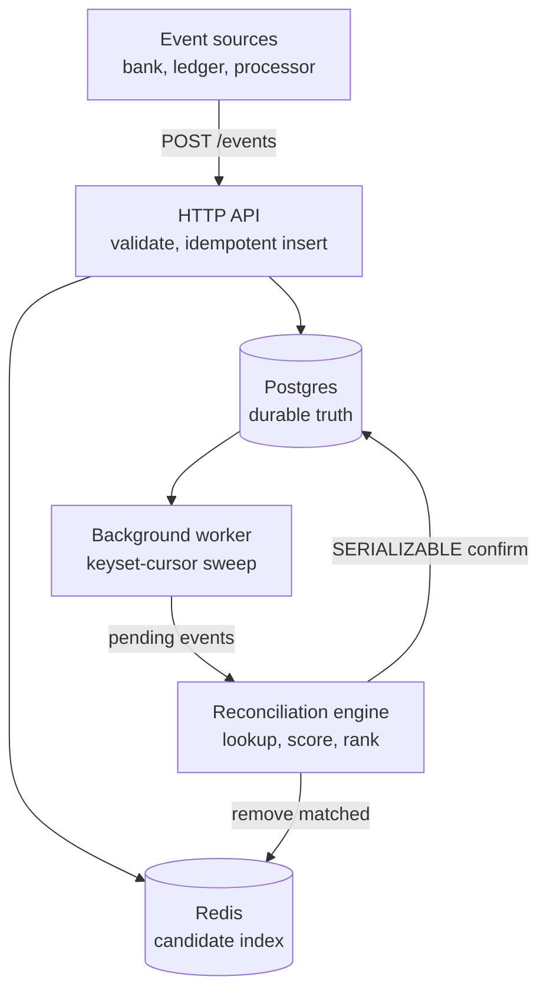

# Tally: An exercise in concurrency and reconciliation

Tally is a reconciliation engine built from scratch in Go. The same payment shows up in more than one system, such as a bank statement and a company's own ledger, with different IDs and descriptions on each side. Tally works out which records describe the same real-world transaction and confirms each match exactly once, while events arrive concurrently and out of order.

Every cell is one event from a real bank-to-ledger dataset: 149,854 of them, posted by 16 concurrent workers and cleared by a background sweep. On that run Tally matched 93.2% of the known pairs, with a 4.7% false-positive rate, and the whole corpus was reconciled 210 seconds after the first event arrived. The coloured cells at the end are everything left unmatched, sorted by reason.

## The data

Tally is measured on **BenchRec**, a cash reconciliation dataset released for an ICAIF 2023 competition under CC BY 4.0. It contains real bank statement lines and the internal ledger entries they were reconciled against at one institution, anonymized with the structure kept intact.

| | |
|---|---|
| Rows | 149,854 |
| Known matches | 56,074 |
| One bank line to one ledger entry | 47,024 (83.9%) |
| Many-to-many groups and one-sided entries | the remaining 16.1% |

It is a useful test because it has the problems that make reconciliation hard in practice:

- **No shared ID.** The bank and the ledger name the same payment differently. All that links them is the amount, the date, the account, and free-text reference strings.
- **Look-alikes.** Many payments share an amount and a date. 12.6% of ledger entries have more than one plausible counterpart.
- **Not everything pairs off.** Batched settlements and split payments mean one entry can settle several, and some entries have no counterpart at all. A matcher has to leave those alone.
- **Some cases needed a person.** 3.8% of the one-to-one pairs were matched by hand in the original data. Those are the cases the institution's own rules could not resolve.
- **A wrong match costs more than a missing one.** An unmatched entry gets reviewed. A wrong match hides a real discrepancy behind a record that looks settled.

Its limits: one account, one currency, dates rather than timestamps, and one institution's custody flows. It says little about card, ACH, or crypto reconciliation. The dataset files are not redistributed here.

## Three ideas that carry the engine

### Deferred confirmation

Tally first tried to match each event the moment it arrived. That meant choosing from whatever happened to be pending at that instant, so a look-alike that arrived early would be accepted before the true partner existed. Confirmation now runs on a background sweep, after candidates have had time to arrive, and the best one is chosen by comparison.

Same 2,055 events, 666 known pairs, 16 workers:

| | On arrival | Deferred |
|---|---|---|
| Match rate | 0.9189 | **0.9565** |
| False positives | 49 | **23** |
| Ingest throughput | 979 events/sec | **2,878 events/sec** |
| Median time to match | **247 ms** | 2,332 ms |

The cost is latency. A match now waits for the next sweep, and during a large backfill it waits behind the queue.

### Candidate lookup

An event is never compared with the whole backlog. The lookup keeps only pending entries from the other source with the same amount, within one cent, inside the time window. Only those are scored.

Measured on the full corpus loaded as pending (149,854 events), over 1,000 sampled events, against a baseline that scores every pending entry from the other source:

| | Whole backlog | Narrowed |
|---|---|---|
| Entries scored per event (mean) | 74,570 | **4.6** |
| Entries scored per event (median) | 68,975 | **1** |
| Lookup and scoring time (median) | 611 ms | **1.9 ms** |

That is **323 times faster**, and the two approaches reached the same decision for all 1,000 events. The baseline is hypothetical: Tally never ran without narrowing.

The narrowing is also a ceiling. 97.4% of true pairs agree to within a cent. The other 2.6% are never scored.

### Scoring

Each candidate gets a weighted score from four signals: amount, time, account, and how much of the reference text the two records share.

- **Text is compared by character, not by word.** References are often embedded in longer strings, such as `V41806706` inside `V418067061617140`. Six-character fragments find shared text in **82.4%** of true pairs. Whole-word comparison finds it in **25.0%**.
- **A different account is a veto, not a penalty.** Without it, two records identical in every way except the account scored 0.85 and were confirmed.
- **The best candidate wins, not the first to clear a bar.** A look-alike with the right amount, date and account but no shared text scores 0.80, just above the 0.79 floor. It only loses because a better candidate is ranked above it.

### Where that leaves it

On the full corpus, these changes together took the match rate from 0.8873 to **0.9321** and false positives from 4,615 to **2,179**. In the run shown at the top, all 149,854 events were ingested in 35 seconds and the backlog was fully drained by 210 seconds.

What is not solved:

- The 4.7% false-positive rate. Refusing to confirm when the top two candidates are nearly tied is the next step and is not built.
- Hand-matched pairs. Tally finds 13.4% of them, because most differ by more than a cent or a day and never reach scoring.
- Many-to-many matches. Only one-to-one pairs are matched.

## Under the hood

**Stack**

| | |
|---|---|
| Language | Go |
| HTTP | chi |
| Storage | Postgres 16 through pgx, with `SERIALIZABLE` transactions for match confirmation |
| Candidate index | Redis 7 sorted sets |
| Observability | zerolog, Sentry |
| Delivery | Distroless Docker image, Kubernetes manifests, GitHub Actions with a correctness benchmark gate |

**Schema**

| Table | Holds |
|---|---|
| `canonical_events` | Every ingested event: tenant, source, amount in minor units, timestamp, account, reference text, and a `match_status` of `PENDING` or `MATCHED`. Unique on an idempotency key, so replays are safe. |
| `matches` | One row per confirmed match, with its score and the scoring evidence as JSON. |
| `match_events` | Links each match to the events it joins. |

**Parts**

Two concurrent workers can never both claim the same event: confirmation checks that both events are still pending inside a serializable transaction and retries on conflict.

## More

- [Engineering notes](docs/engineering.md): design rationale, full results by match rule, known limitations, and how to run everything locally.
- The animations are rendered from code in [`viz/`](viz/). The one at the top is drawn from a recorded trace of a real run (`make viz-trace`, then `make viz`).
- [Spec](docs/spec.md) and [progress tracker](docs/progress.md).

The BenchRec cash reconciliation dataset v1.0 (ICAIF 2023) is used under [CC BY 4.0](https://creativecommons.org/licenses/by/4.0/).
